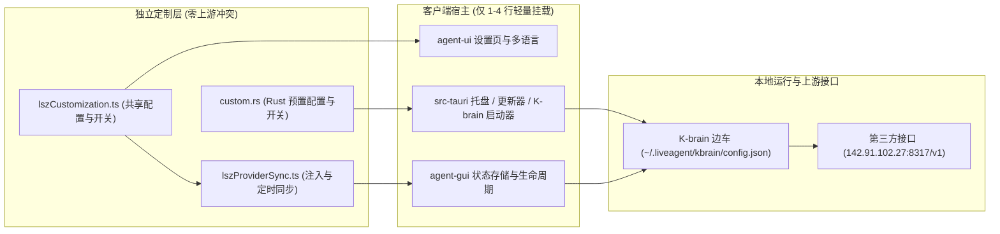

# LszAgent 项目完整交接文档（Handoff Guide）

> [!IMPORTANT]
> 本文档为 `LszAgent` 二次开发、日常换源、上游同步与自动化发版的独立交接手册（与仓库内偏代码挂载说明的 [LSZAGENT_CUSTOMIZATION.md](file:///root/.gemini/antigravity/scratch/LiveAgent/docs/LSZAGENT_CUSTOMIZATION.md) 配套互补）。当前仓库已转为 **Public 公开仓库**以支持官方在线自动更新程序直接读取 GitHub Releases 与 `latest.json`。

---

## 1. 项目与环境资产总览

| 资产项 | 详情 |
| --- | --- |
| **软件品牌名称** | `LszAgent`（基于 LiveAgent `v2.0.39` 深度解耦定制） |
| **GitHub 仓库（`origin`）** | https://github.com/lszdevlop/LszAgent （Public 公开仓库，同时作为在线自动更新源，默认分支：`main`） |
| **上游开源仓库（`upstream`）** | https://github.com/Stack-Cairn/LiveAgent.git |
| **正式 Release 下载页** | https://github.com/lszdevlop/LszAgent/releases/tag/v2.0.39 |
| **成功发版 Actions 记录** | https://github.com/lszdevlop/LszAgent/actions/runs/45785700220 |
| **本地源码仓库路径** | [LiveAgent](file:///root/.gemini/antigravity/scratch/LiveAgent) |
| **本地已拉取正式安装包目录** | [dist-release](file:///root/.gemini/antigravity/scratch/LiveAgent/dist-release) |
| **方案一（解包重打包版）留档目录** | [liveagent-custom-installer](file:///root/.gemini/antigravity/scratch/liveagent-custom-installer) |

### 内置第三方供应商参数（当前生效值）
- **供应商 ID / 显示名**：`lsz-builtin` / `默认接口`
- **协议类型**：`type: "codex"` + `api: "openai-responses"`（原生支持推理、多模态视觉与联网工具；同时兼容 `/v1/chat/completions`）
- **Base URL**：`http://142.91.102.27:8317/v1`
- **API Key**：见 `lszCustomization.ts` / `custom.rs`（或构建期 Secrets）
- **默认模型策略**：**不指定静态默认模型**（首次安装进入对话页显示“选择模型”，由用户自行从实时列表中挑选；选定后自动记忆）
- **模型列表自动同步**：启动即同步 + 后台每 `5` 分钟轮询 `/v1/models` + 窗口切回前台 / 网络恢复时触发（带 `60` 秒最小防抖间隔）
- **在线自动更新**：已启用官方在线更新程序，默认检测仓库为 `lszdevlop/LszAgent`（支持稳定版 / 预发布通道、`latest.json` 自动签名校验一键升级与版本更新公告）

---

## 2. 已交付安装包清单（v2.0.39）

正式版全平台安装包均已托管至 https://github.com/lszdevlop/LszAgent/releases/tag/v2.0.39 ：

| 平台 | 产物文件 | 体积 | 校验与使用备注 |
| --- | --- | --- | --- |
| **Windows x64** | [LszAgent-v2.0.39-Windows-x64-Setup.exe](file:///root/.gemini/antigravity/scratch/LiveAgent/dist-release/LszAgent-v2.0.39-Windows-x64-Setup.exe) | 82.7 MB | 主力安装包（内置在线自动更新），SHA-256: `427167f7c041f41b762190458678df3bd6d76068dfbcf9d3b9379ab83d9f5c13` |
| **Windows x64** | [LszAgent-v2.0.39-Windows-x64.msi](file:///root/.gemini/antigravity/scratch/LiveAgent/dist-release/LszAgent-v2.0.39-Windows-x64.msi) | 97.9 MB | 企业部署 MSI 安装包 |
| **Windows x64** | [LszAgent-v2.0.39-Windows-x64-portable.zip](file:///root/.gemini/antigravity/scratch/LiveAgent/dist-release/LszAgent-v2.0.39-Windows-x64-portable.zip) | 97.6 MB | 免安装便携压缩包 |
| **macOS (Apple Silicon)** | `LszAgent-v2.0.39-macOS-aarch64.dmg` | 150.0 MB | 未配置苹果开发者证书，首次打开若遇拦截请执行：`xattr -cr /Applications/LszAgent.app` |
| **macOS (Intel)** | `LszAgent-v2.0.39-macOS-x64.dmg` | 152.4 MB | 同上，首次打开可执行 `xattr -cr /Applications/LszAgent.app` |
| **Linux x64** | `LszAgent-v2.0.39-Linux-x86_64.AppImage` | 175.2 MB | 基于 Ubuntu 22.04 (`GLIBC <= 2.35`) 构建，兼容 Ubuntu 22.04+ / Debian 12+ |
| **Linux x64** | `LszAgent-v2.0.39-Linux-x86_64.deb` | 106.4 MB | Debian / Ubuntu 原生包 |
| **Linux x64** | `LszAgent-v2.0.39-Linux-x86_64.rpm` | 106.3 MB | RHEL / Fedora / Rocky 原生包 |

---

## 3. 解耦定制架构与代码地图



### 3.1 三个核心定制文件（后续修改优先只动这里）
1. [lszCustomization.ts](file:///root/.gemini/antigravity/scratch/LiveAgent/crates/agent-ui/src/lib/custom/lszCustomization.ts)
   - 定义 `LSZ_APP_NAME`、`LSZ_DISABLE_API_KEY_REVEAL`、`LSZ_DISABLE_AUTO_UPDATE`、`LSZ_BUILTIN_PROVIDER`、`LSZ_MODEL_SYNC_INTERVAL_MS` 以及用户手选模型状态持久化工具函数。
2. [lszProviderSync.ts](file:///root/.gemini/antigravity/scratch/LiveAgent/crates/agent-gui/src/lib/custom/lszProviderSync.ts)
   - 负责首次启动兜底注入内置供应商、抑制 K-brain 自动字典序默认模型（`resolveLszEffectiveSelectedModel`）、记录用户主动选模（`recordLszModelSelectionChange`）以及后台定时拉取上游 `/models`（`useLszPeriodicModelSync`）。
3. [custom.rs](file:///root/.gemini/antigravity/scratch/LiveAgent/crates/agent-gui/src-tauri/src/custom.rs)
   - 定义 Rust 端 `APP_NAME`、`DISABLE_AUTO_UPDATE`，并在全新机器首次拉起 `k-brain` 前原子写入初始 `~/.liveagent/kbrain/config.json`。

### 3.2 配套测试与 CI 工作流
- 定制逻辑单测：[lsz-customization.test.mjs](file:///root/.gemini/antigravity/scratch/LiveAgent/crates/agent-gui/test/custom/lsz-customization.test.mjs)
- 密钥脱敏单测：[provider-modal-api-key-mask.test.mjs](file:///root/.gemini/antigravity/scratch/LiveAgent/crates/agent-gui/test/settings/provider-modal-api-key-mask.test.mjs)
- 全平台打包发布流水线：[desktop-release.yml](file:///root/.gemini/antigravity/scratch/LiveAgent/.github/workflows/desktop-release.yml)

---

## 4. 常见运维操作手册

### 4.1 更换内置 Base URL 或 API Key
有两种方式（任选其一）：
- **方式 A（改源码常量）**：同步修改 [lszCustomization.ts](file:///root/.gemini/antigravity/scratch/LiveAgent/crates/agent-ui/src/lib/custom/lszCustomization.ts) 与 [custom.rs](file:///root/.gemini/antigravity/scratch/LiveAgent/crates/agent-gui/src-tauri/src/custom.rs) 中的 `BUILTIN_BASE_URL` / `BUILTIN_API_KEY`，提交并打新 Tag 发版。
- **方式 B（构建期环境变量覆盖，无需改代码）**：在构建环境或 `.github/workflows/desktop-release.yml` 中注入：
  - 前端环境变量：`VITE_LSZ_BASE_URL`、`VITE_LSZ_API_KEY`、`VITE_LSZ_PROVIDER_NAME`
  - Rust 编译期环境变量：`LSZ_BUILTIN_BASE_URL`、`LSZ_BUILTIN_API_KEY`

> [!TIP]
> 客户端已安装的存量老用户本地已有 `~/.liveagent/kbrain/config.json`。若希望新安装包覆盖老机器上的内置供应商地址/Key，可在 `lszProviderSync.ts` 的 `ensureLszBuiltinProviderSeeded` 中对 `lsz-builtin` 执行更新写入（同时不要覆盖用户自己新增的其他供应商）。

### 4.2 同步上游 `Stack-Cairn/LiveAgent` 最新版本
```bash
cd /root/.gemini/antigravity/scratch/LiveAgent

# 1. 拉取上游最新代码与标签
git fetch upstream --tags

# 2. 合并上游 main 分支
git merge upstream/main

# 3. 执行全套静态门禁与定制单元测试
pnpm install --frozen-lockfile
pnpm check:ui-boundaries && pnpm typecheck:ui && pnpm typecheck:gui && pnpm typecheck:webui
pnpm lint && pnpm check:knip && pnpm check:file-size
node --test crates/agent-gui/test/custom/lsz-customization.test.mjs \
  crates/agent-gui/test/settings/provider-modal-api-key-mask.test.mjs \
  crates/agent-gui/test/i18n/translations.test.mjs \
  crates/agent-gui/test/i18n/no-cjk-ui-literals.test.mjs

# 4. 推送到私有仓库
git push origin main
```

### 4.3 触发编译并发布新版本安装包（含在线自动更新）
仓库 Actions Secrets 中已配置专属 Tauri 更新器签名密钥（`TAURI_SIGNING_PRIVATE_KEY`、`TAURI_SIGNING_PRIVATE_KEY_PASSWORD`、`TAURI_UPDATER_PUBLIC_KEY`），且对应公钥已写入 [tauri.conf.json](file:///root/.gemini/antigravity/scratch/LiveAgent/crates/agent-gui/src-tauri/tauri.conf.json)。

```bash
# 版本号需符合语义化版本（vX.Y.Z），Desktop Release 会自动签名更新产物并上传 latest.json
# 已安装旧版 LszAgent 的客户端会自动从 lszdevlop/LszAgent/releases.atom 检测到新版本并提示一键更新
git tag -a v2.0.40 -m "LszAgent v2.0.40"
git push origin v2.0.40
```
也可在 GitHub 仓库页面进入 **Actions → Desktop Release → Run workflow** 手动输入已有 Tag 触发重编。日常若只推送文档或非发布代码且不想消耗私有仓库 Actions 分钟数，可在提交信息末尾加上 `[skip ci]`。

---

## 5. 接手必读：历史踩坑记录与工程红线

> [!WARNING]
> 上游仓库设有极其严格的代码规范、包边界与大文件体积门禁，二次开发时请务必避开以下已验证的坑点：

1. **K-brain `config.json` 字段严格校验（错字段会导致后端无法启动）**
   - `K-brain` Go 后端解析 `~/.liveagent/kbrain/config.json` 开启了严格未知字段拒绝（`DisallowUnknownFields`）。
   - 模型最大输出 Token 字段名在落盘 `config.json` 中**必须写 `maxTokens`**（绝对不能写成前端类型里的 `maxOutputToken`，否则 `k-brain backend -prepare-storage` 会直接报 `json: unknown field "maxOutputToken"` 退出）。
2. **K-brain 空默认模型自动填充机制**
   - 调用 `K-brain` 的 `PUT /v1/settings` 保存供应商时，即使传入 `defaultProvider: ""` / `defaultModel: ""`，`K-brain` 仍会自动按字母序把第一个模型填回 `defaultModel`。
   - 因此前端必须保留 [lszProviderSync.ts](file:///root/.gemini/antigravity/scratch/LiveAgent/crates/agent-gui/src/lib/custom/lszProviderSync.ts) 中的 `resolveLszEffectiveSelectedModel`，在 `localStorage` 标记 `lszagent.user-selected-model.v1` 未置位前屏蔽该自动回填，从而真正实现“不指定默认模型”。
3. **超大文件行数门禁（`pnpm check:file-size`）**
   - [file-size-allowlist.json](file:///root/.gemini/antigravity/scratch/LiveAgent/scripts/budgets/file-size-allowlist.json) 锁定了 50 个超过 1500 行的历史文件（如 `enUSCommon.ts`、`zhCNCommon.ts`、`ProviderModalView.tsx`、`kbrain_backend.rs`），行数增加会直接报错。
   - 改应用名等文案请继续在 [hostTranslations.ts](file:///root/.gemini/antigravity/scratch/LiveAgent/crates/agent-ui/src/i18n/hostTranslations.ts) 中覆写键值，切勿直接增删 `enUSCommon.ts` / `zhCNCommon.ts`。
4. **前端源码禁中文字符串门禁（`no-cjk-ui-literals.test.mjs`）**
   - AST 检查会拦截前端源码（不含 `i18n/`）中的任何中文字符及 `\uXXXX` 中文转义字面量。若需在纯逻辑模块放置中文回退名，请使用 `String.fromCharCode(...)` 或走 i18n 字典。
5. **Rust 托盘菜单与 macOS 无证书签名细节**
   - Tauri `Menu::with_items(app, &menu_items)` 动态拼装菜单切片时，`PredefinedMenuItem::separator(app)?` 必须先绑定具名局部变量（见 [tray.rs](file:///root/.gemini/antigravity/scratch/LiveAgent/crates/agent-gui/src-tauri/src/services/tray.rs)），不可在 `vec![...]` 内取临时值引用（会触发 `rustc E0716`）。
   - GitHub Actions 未配置 `APPLE_SIGNING_IDENTITY` 密钥时，构建无签名 `.app` 必须执行 `env -u APPLE_SIGNING_IDENTITY`，否则空字符串环境变量会让 `tauri-bundler` 调用 `codesign -s ""` 导致打包失败（已在 [desktop-release.yml](file:///root/.gemini/antigravity/scratch/LiveAgent/.github/workflows/desktop-release.yml) 中处理妥当）。
